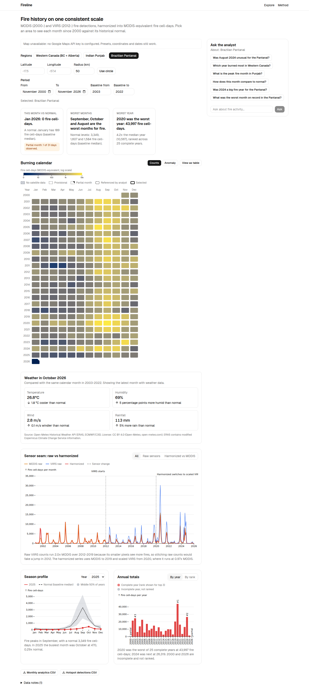

# Fireline

Pick any area, see how much it has burned each month since 2000 on one consistent scale, see whether the current month is abnormal, and download the numbers.

Fireline merges NASA FIRMS MODIS (2000-, 1 km) and VIIRS (2012-, 375 m) hotspots into one harmonized series of MODIS-equivalent fire cell-days, so the 26-year MODIS record keeps going after Terra and Aqua retire.

- Live app: _TBD (Cloud Run URL after deploy, #23)_
- Demo video: _TBD (#29)_
- Method and validation: [docs/METHOD.md](docs/METHOD.md), also served at `/method` in the app
- Data (public, no login): https://storage.googleapis.com/fireline-space-apps-data/public/v1/index.json
- Challenge: [NASA Space Apps 2026, Harmonization of MODIS and VIIRS Hot Spots](https://www.spaceappschallenge.org/2026/challenges/modis-and-viirs-hot-spots/)



## Why

VIIRS sees several times more hotspots than MODIS for the same fires, because its pixels are smaller. Stitch the raw counts together and the record jumps in 2012 for reasons that have nothing to do with fire. Terra and Aqua MODIS stop in 2027, and FIRMS stopped new Suomi NPP data in November 2026, so the long record has to continue on NOAA-20 and NOAA-21 VIIRS. Fireline expresses VIIRS in MODIS units so 2024 can be compared with 2005.

## What it does

- Pick an area: a preset (Brazilian Pantanal, Western Canada (BC + Alberta), Indian Punjab), a point and radius, a drawn polygon or a place search. Drawing and search need a Google Maps key.
- Burning calendar: one row per year, one column per month, in counts or anomalies, with a table view for screen readers and keyboards.
- Summary cards: this month against normal, the worst months and years, and a trend only when the data supports one. A partial month shows its count and the normal level but isn't compared with a full-month baseline.
- Sensor seam chart: raw MODIS, raw VIIRS and the harmonized line side by side.
- Season profile, annual totals, monthly weather anomalies for presets, and (with a Maps key) a hexagon map of a selected month.
- CSV downloads: one row per month with all statistics, and every cleaned hotspot in the area.
- An AI analyst (Gemini on Vertex AI) whose numbers all come from tool calls on the same data, with a "How I got this" trace.
- An MCP server ([mcp/](mcp/README.md)) so Claude and other assistants can query the same fire history.

## How it works

1. **Data:** FIRMS MODIS C6.1 (Terra, Aqua) and VIIRS 375 m (Suomi NPP, NOAA-20) hotspots, standard files through December 2025.
2. **Cleaning:** vegetation fires only, MODIS confidence 30 or higher, VIIRS nominal or high confidence, local solar dates.
3. **Common unit:** a fire cell-day is one H3 resolution-8 cell (about one MODIS pixel) with at least one detection from one satellite on one local day. Several VIIRS points in one cell count once.
4. **Calibration:** per region and calendar month, k = MODIS cell-days / VIIRS cell-days over 2012-2019, with 90% bands from resampling whole years.
5. **Splice:** observed MODIS through 2019, k x VIIRS from January 2020. The series keeps running after MODIS ends.
6. **Validation:** over 2012-2019 the raw VIIRS/MODIS ratio is 2.18x (Pantanal), 2.98x (Western Canada) and 4.44x (Punjab); harmonized it is 1.06x, 1.18x and 1.14x. An independent check against ESA Sentinel-3 SLSTR in the Pantanal gives Spearman r = 0.866.

Details, limitations and references: [docs/METHOD.md](docs/METHOD.md).

## Repo layout

| folder | what |
|---|---|
| `pipeline/` | Python data pipeline: download, clean, aggregate, calibrate, splice, validate, export |
| `app/` | Next.js app and API (DuckDB over Parquet) |
| `mcp/` | MCP server exposing the fire-history tools |
| `contracts/` | shared data and API formats, plus mock data |
| `docs/` | method write-up and submission text |
| `infra/` | Google Cloud setup |
| `scripts/` | data fetch and deploy scripts |

## Run locally

App (Node 24). With no setup it reads the mock data in `contracts/mock/` (Pantanal only):

```bash
cd app
npm install
npm run dev
```

Production data for all three regions:

```bash
scripts/fetch-data.sh                         # downloads public/v1 into data/v1 (about 110 MB)
cd app && APP_DATA_DIR=../data/v1 npm run dev
```

Optional env vars (see `.env.example`): `NEXT_PUBLIC_GOOGLE_MAPS_API_KEY` for the map, drawing and search; `GOOGLE_MAPS_SERVER_KEY` for place names in the analyst; `GOOGLE_CLOUD_PROJECT` with Application Default Credentials for the analyst's free-form questions. The example questions work without any of them.

Pipeline (Python 3.13, uv):

```bash
cd pipeline
uv sync
uv run pytest
```

Container:

```bash
docker build -t fireline .
docker run -p 8080:8080 fireline
```

The image ships `data/v1/` if `scripts/fetch-data.sh` has run, and the mock data otherwise.

## Deploy

`scripts/deploy.sh` builds with Cloud Build and deploys to Cloud Run. See [scripts/README.md](scripts/README.md) and [infra/README.md](infra/README.md).

## Data sources

- NASA FIRMS MODIS Collection 6.1 and VIIRS 375 m active fires. We acknowledge the use of data from NASA LANCE FIRMS, part of NASA ESDIS.
- ESA Copernicus Sentinel-3 SLSTR FRP through Microsoft Planetary Computer (validation). Contains modified Copernicus Sentinel data (2020-2025), processed by ESA.
- Open-Meteo Historical Weather API (ERA5), CC BY 4.0. Contains modified Copernicus Climate Change Service information.
- Region boundaries: IBGE biomes (Pantanal), Natural Earth Admin 1 (British Columbia, Alberta, Punjab).

Full citations: [docs/SUBMISSION.md](docs/SUBMISSION.md), sections 7 and 8.

## Team

_TBD_

## License

Apache-2.0. See [LICENSE](LICENSE).
